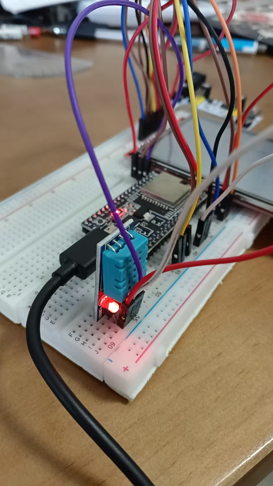
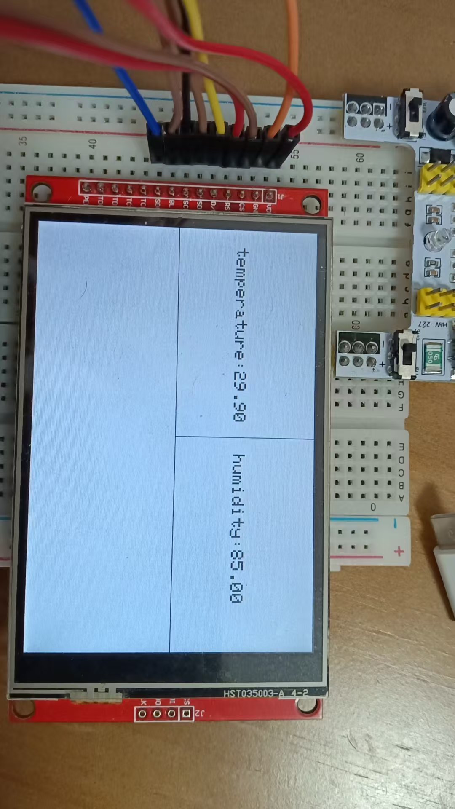

# ESP32 联网天气时钟

> 3.5 寸彩屏上的实时时钟 + 和风天气 + 本地温湿度，纯 WiFi 联网，无 SD 卡依赖。
> 用 PlatformIO 开发，代码按模块拆分，全中文注释。

| 整机 | 屏幕正面 |
|:---:|:---:|
|  |  |

## 功能

- **实时时钟**　NTP 自动对时，显示 时:分:秒 / 月日 / 星期，秒为红色
- **实时天气**　和风天气 API，显示 天气现象 / 温度 / 体感温度 / 湿度 / 风力
- **本地监测**　DHT11 采集环境温湿度，显示在右上角独立区块
- **触摸配网**　无 WiFi 时自动开热点，手机浏览器填一下就能连上，不需要烧录
- **中文显示**　自制 28px 点阵字库，中文界面
- **断线自恢复**　掉线自动重连，重连后自动补拉天气

## 硬件

| 器件 | 规格 |
|---|---|
| 主控 | ESP32-DevKitC（ESP32-32D） |
| 屏幕 | 3.5 寸 SPI TFT，320×480，ILI9488 驱动（带触摸，未启用） |
| 传感器 | DHT11 温湿度模块 |
| 存储 | 无 SD 卡 |

完整接线表见 **[docs/wiring.md](docs/wiring.md)**。

## 快速开始

### 1. 拉代码

```bash
git clone https://github.com/zhiming2008/esp32-weather-clock.git
cd esp32-weather-clock
```

### 2. 配置密钥

复制密钥模板并填入自己的值：

```bash
cp include/secrets.example.h include/secrets.h
```

```cpp
#define HEFENG_API_KEY "你的和风天气APIKey"
#define CITY_ID        "城市代码"   // 城市见下方说明
```

> `include/secrets.h` 已写进 `.gitignore`，不会被提交。
> **API Key 泄露会被人刷配额**，泄露后请立刻到
> [和风天气控制台](https://console.qweather.com/home) 重置。
>
> 城市 ID 查询入口：
> [城市列表](https://dev.qweather.com/docs/resource/location-list/)，
> 也可以直接填经纬度，例如 `"116.41,39.92"`。

### 3. 编译与烧录

```bash
pio run                  # 编译
pio run -t upload        # 烧录
pio device monitor       # 打开串口看日志（115200）
```

### 4. 配网

上电后若没有可用凭据，会开启热点 `ESP32-Weather-Setup`：

1. 手机连接该热点
2. 浏览器打开 `http://192.168.4.1`
3. 填写 WiFi 名称和密码 → 设备连接成功后自动重启

**重新配网**：长按开发板 `BOOT` 键 5 秒。

## 项目结构

```
esp32-weather-clock/
├── README.md
├── LICENSE                     MIT
├── platformio.ini              依赖与构建参数
├── docs/
│   ├── wiring.md               接线表 + 硬件注意点
│   └── images/                 实物照片
├── include/
│   ├── config.h                ★ 全部引脚、布局、配色常量
│   ├── User_Setup.h            TFT_eSPI 显示/触摸配置
│   ├── secrets.example.h       密钥模板
│   └── secrets.h               （本地，已被 .gitignore 忽略）
└── src/
    ├── main.cpp                调度：只做编排，不写业务
    ├── fonts/
    │   ├── Deng28.h            28px 中文点阵字库
    │   └── README.md           字库生成方法
    └── modules/
        ├── Clock.h/.cpp        NTP 对时与本地时间
        ├── Display.h/.cpp      屏幕绘制与局部刷新
        ├── NetManager.h/.cpp   WiFi 连接 + SoftAP 配网
        ├── Sensor.h/.cpp       DHT11 采集（非阻塞、2s 间隔约束）
        └── Weather.h/.cpp      和风天气 API
```

### 模块职责

| 模块 | 职责 |
|---|---|
| `Clock` | NTP 同步、提供本地年月日时分秒 |
| `Sensor` | 按 DHT11 时序约束采集温湿度 |
| `Weather` | 请求和风天气并解析 JSON、失败退避重试 |
| `Display` | 把数据画到屏上，负责局部刷新策略 |
| `NetManager` | 连接维护、配网网页、凭据清除 |
| `main` | 决定各模块多久跑一次 |

各模块之间只通过参数和返回值传递数据，没有全局可变状态：
`Display` 里不含任何网络调用，`Weather` 里不含任何绘图代码。
想加功能只需要接一个新模块进来，`main.cpp` 的改动很小。

## 设计要点（坑）

**1. DHT11 的 2 秒约束必须硬性保证**

DHT11 两次读取间隔不足 2 秒会返回上一次的旧值甚至 `NaN`。
靠 `loop()` 里写 `delay(2000)` 是靠不住的——只要别的地方也用 delay 就失效了。
现在用时间戳判断到期与未到期（`millis()` 差值比较，49 天回绕天然安全）。

**2. 屏幕不能整屏重画**

480×320 全屏刷会明显闪烁。现在按变化频率分块擦除：
秒每 1 秒擦 79×79，分每分钟擦，星期每整点擦，日期每天零点擦。

**3. 刷新条件里的运算符优先级**

旧代码写过
`if ((currentHour == 0) || (currentHour == 24) && currentMinute == 0 && currentSec == 0)`，
`||` 优先级高于 `&&`，实际含义完全不是想表达的那个意思——
结果是星期区域永远不会被擦掉。现在按"秒→分→时→日"的层级分别判断。

**4. 时区不要自己算**

旧代码用 `NTPClient::setTimeOffset(28800)`，那是"每秒猜一次偏移"的做法，
网络抖动就跳变；现在用 ESP32 标准的 `configTime()` + `TZ=CST-8`，由系统处理。

**5. 请求失败退避**

网络断开时如果每秒都去握手，一次 HTTPS 失败会拖慢主循环。
现在失败次数越多、下次重试越久（1min → 2min → 4min → 8min 封顶）。

**6. 数据处理弹性**

DHT 库读失败返回 `NaN`，直接丢给 `String()` 会显示成字符串 `"nan"`。
现在在 `Sensor` 层就挡掉并打日志。

## 重构记录

这个项目最初是 2024 年写的，代码比较乱。重构内容：

| 类别 | 改动 |
|---|---|
| 依赖 | 去掉 gzip 与 ArduinoUZlib 第三方库 —— 旧代码 URL 写 `gzip=n` 却发 `Accept-Encoding: gzip` 再手动解压，自相矛盾；现在直接解析 JSON，少一个依赖、少 3KB 缓冲、少一处手工 `free()` |
| 内存 | 天气模块不再使用 `static uint8_t buf[3072]`（放 DRAM），改用 `HTTPClient` 内部缓冲 |
| 安全 | API Key 从硬编码改为 `secrets.h` + 占位符，原 key 已重置 |
| 安全 | HTTPS 每次请求的 `WiFiClientSecure` 改为 `unique_ptr` 管理，异常路径也不泄漏 |
| 健壮性 | 修复 `doUpdateForecast()` 签名与实现不一致导致的数组越界（签名收单个指针，函数体当数组用） |
| 健壮性 | 修复 `\|\|` 与 `&&` 混用导致的刷新条件失效 |
| 健壮性 | `Serial.begin()` 重复调用已移除；DHT 采样间隔、NTP 时区改用标准做法 |
| 结构 | `Main.ino` 312 行的单文件拆成 6 个模块；`Display_Time()` 单函数 130 行按职责拆开 |
| 结构 | 全局变量 `float h, t` 收进 `Sensor` 类，不再跨函数隐式依赖 |
| 工程 | `User_Setup.h` 从 `.pio/libdeps/` 第三方库私有目录移到 `include/`，跟着仓库走 |
| 工程 | 依赖全部由 `lib_deps` 声明，不再 vendor 第三方源码 |
| 工程 | 补齐 `.gitignore`、`LICENSE`、README、接线表 |
| 清理 | 删除 60 行以上注释掉的死代码；配置项与布局坐标全部提为具名常量 |

## 已知限制

- 屏幕的触摸功能硬件上有，本项目**未启用**（没有交互需求）
- 天气图标只映射到了自制字库里的槽位，没有用官方 PNG 图标
- 天气 API 免费版更新频率约 10 分钟，`WEATHER_REFRESH_MINUTES` 已按此设置
- 断网时显示的是最后一次成功获取的数据（不回退到假数据）
- `tls->setInsecure()` 未校验证书链，生产环境建议把和风天气的根证书烧进 NVS 后改用 `setCACert()`

## License

[MIT](LICENSE)
